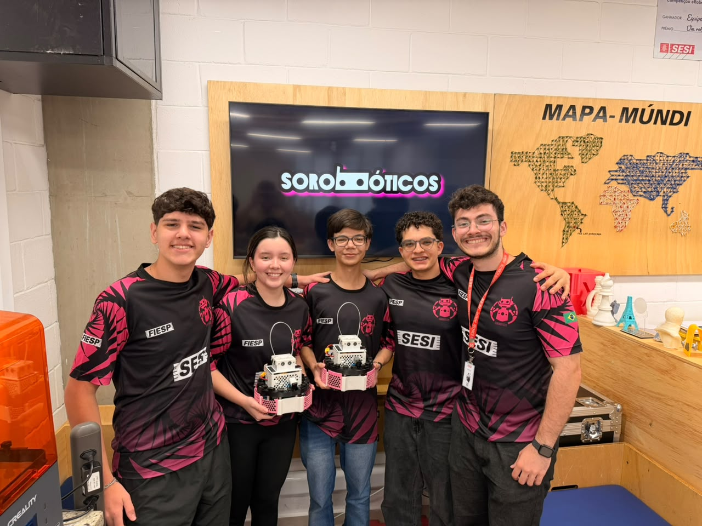

# Sorobóticos
### RoboCupJunior Soccer Infrared · Nacional 2026

**SESI CE 123 · Sorocaba, São Paulo · Brasil**

[Documentação técnica](tdp/TDP.md) · [Programação](code/README.md) · [Lista de materiais](electronics/bom.csv) · [Pôster](poster/README.md)

## A equipe

Somos a Sorobóticos, equipe de robótica do SESI CE 123 de Sorocaba. Desenvolvemos dois robôs autônomos de futebol — atacante e goleiro — integrando programação, eletrônica e fabricação digital.

Nossa estreia no Soccer em 2025/2026 conquistou o **1º lugar na categoria Rookie da etapa regional**. Este repositório reúne o trabalho para a etapa nacional de 2026.

| Integrante | Área |
| --- | --- |
| Bruno Proença | Integração de software |
| Henrique Cabral | Desenvolvimento de software |
| Gabriela Reche | Projeto mecânico |
| Heitor Ferreira | Integração de hardware |

## Explore o projeto

| Área | O que você encontra |
| --- | --- |
| [TDP](tdp/TDP.md) | Descrição técnica completa, estratégias, desenvolvimento e imagens dos robôs |
| [Programação](code/README.md) | Firmware C++ para os núcleos M4 e M7 de cada robô |
| [Eletrônica e BOM](electronics/README.md) | Componentes, custos, ferramentas e bibliotecas em CSV |
| [Mecânica e CAD](cad/README.md) | Chassi, rodas e suportes em Fusion 360, STEP e STL |
| [Pôster](poster/README.md) | Apresentação visual do projeto e PDF para leitura |
| [SoroSoccer](simulator-sorosoccer/README.md) | Simulação e desenvolvimento de estratégias |

## Arquitetura dos robôs

O **Arduino GIGA R1 WiFi** distribui o processamento entre os dois núcleos: o M4 adquire os sinais infravermelhos e o M7 executa o controle. Quatro motores DC de 1000 RPM e rodas omnidirecionais permitem deslocamentos laterais e diagonais, com orientação pelo BNO055 e leitura de distâncias por ultrassônicos.

| Robô | Percepção no M4 | Controle no M7 |
| --- | --- | --- |
| Atacante | 16 TSOPs; direção 0–15 | Busca e condução da bola, orientação e movimentação |
| Goleiro | 11 TSOPs; direção 1–11 | Acompanhamento lateral da bola e posicionamento defensivo |

A estrutura é modelada no Fusion 360 e fabricada por impressão 3D. Rodas duplas e encaixes tipo cauda de andorinha fazem parte do desenvolvimento mecânico da equipe.

## Comece por aqui

1. Leia o [TDP](tdp/TDP.md) para conhecer as decisões de projeto.
2. Consulte a [BOM](electronics/bom.csv) e os [arquivos CAD](cad/README.md).
3. Siga as [instruções de gravação](code/README.md) para preparar o firmware.

## Contato e licença

Acompanhe a equipe no [Instagram](https://www.instagram.com/_soroboticos/). Os contatos dos integrantes estão no [TDP](tdp/TDP.md#contato).

Disponibilizado sob a [licença MIT](LICENSE). Ferramentas e bibliotecas externas mantêm suas respectivas licenças.
