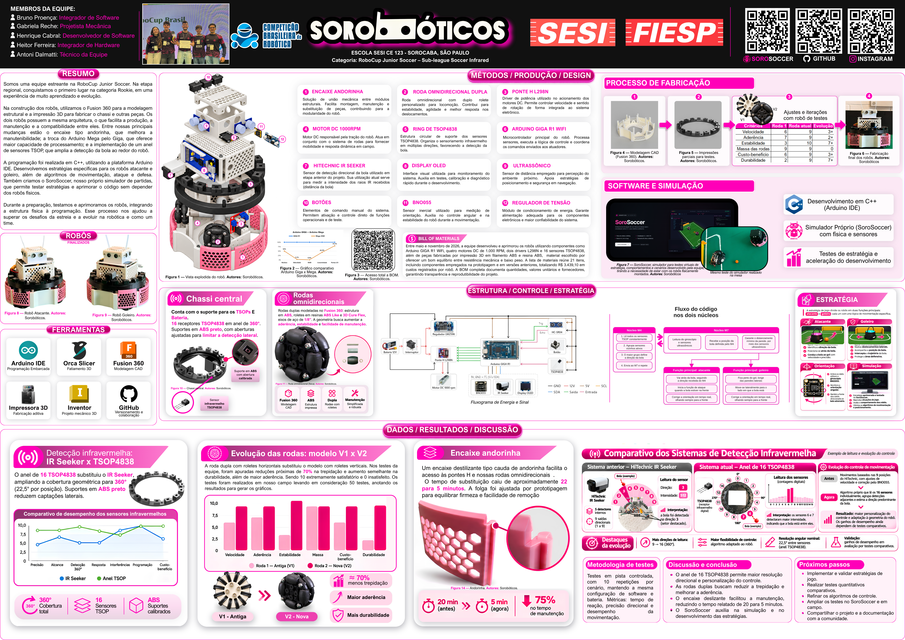

# Sorobóticos — Nacional Soccer 2026

Repositório da equipe Sorobóticos, da Escola SESI CE 123 de Sorocaba (SP), para a RoboCupJunior Soccer — Soccer Infrared 2026.

## Documentação

- [Pôster da equipe em resolução original](poster/banner-soccer-2026.png) e [notas do pôster](poster/README.md)
- [TDP completo](tdp/TDP.md) e [imagens do TDP](tdp/media/)
- [Lista de materiais — BOM](electronics/bom.csv) e [conferências de custos](electronics/README.md)
- [Projetos mecânicos e arquivos CAD](cad/README.md)
- [Simulador SoroSoccer](simulator-sorosoccer/README.md)

## Programação

Os códigos fornecidos pela equipe estão organizados por robô e núcleo do Arduino GIGA R1 WiFi. O M4 lê os TSOPs e envia a direção por RPC; o M7 recebe os dados e executa movimentação, orientação, ultrassônicos e OLED.

| Robô | M4 — sensores | M7 — controle |
| --- | --- | --- |
| Atacante | [atacante_m4.ino](code/atacante/atacante_m4/atacante_m4.ino) | [atacante_m7.ino](code/atacante/atacante_m7/atacante_m7.ino) |
| Goleiro | [goleiro_m4.ino](code/goleiro/goleiro_m4/goleiro_m4.ino) | [goleiro_m7.ino](code/goleiro/goleiro_m7/goleiro_m7.ino) |

Consulte as [instruções de gravação e dependências](code/README.md), a [pinagem dos TSOPs](code/pinagem-tsop.csv) e o [protocolo M4 → M7](code/protocolo-rpc.md). O [goleiro](code/goleiro/README.md) acompanha a bola lateralmente e volta à posição de referência pelos ultrassônicos quando perde a detecção. A compilação para a placa e os testes em hardware ainda precisam ser realizados.

O atacante usa 16 TSOPs e o goleiro usa 11 nesta versão do código. O pôster registra outra apresentação do projeto e contém valores de custos diferentes da BOM; veja as [notas](poster/README.md).

## Licença

Este projeto é disponibilizado sob a [licença MIT](LICENSE). Bibliotecas e ferramentas externas mantêm suas próprias licenças.
