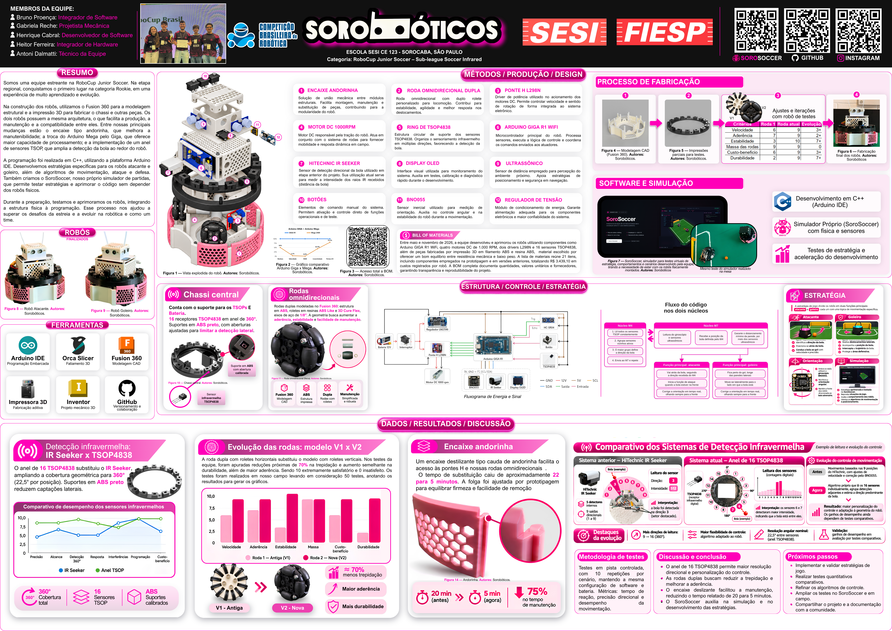

# Pôster — Sorobóticos 2026

[Pôster original em PNG](banner-soccer-2026.png), fornecido pela equipe e preservado sem redimensionamento ou edição.

O material apresenta equipe, fabricação, arquitetura dos robôs, sensores, estratégias, SoroSoccer e resultados relatados pela equipe. Consulte também o [TDP](../tdp/TDP.md), os [arquivos CAD](../cad/README.md) e a [programação M4/M7](../code/README.md).

## Notas de versão

- O pôster destaca o anel de 16 TSOP4838. Nos códigos publicados, o atacante usa 16 sensores e o goleiro usa 11, com lacuna traseira.
- O pôster apresenta R$ 3.439,10; a [BOM publicada](../electronics/README.md) soma R$ 3.397,10 em itens precificados, e o TDP cita R$ 3.197,10. Os valores das fontes foram preservados e ainda precisam de conciliação.
- O pôster cita redução do tempo de manutenção de aproximadamente 22 para 5 minutos no texto e de 20 para 5 minutos no quadro. Os resultados são relatos da equipe; dados brutos de validação não acompanham este arquivo.
- As instruções de compilação e as particularidades dos códigos estão nos READMEs de programação. O pôster não substitui a pinagem específica de cada robô.

[Licença MIT](../LICENSE) · [Início](../README.md)
