# Technical Description Paper

**Sorobóticos · RoboCupJunior Soccer Infrared · 2026**

[Início](../README.md) · [BOM](../electronics/bom.csv) · [Pôster](../poster/README.md)

## Nome do Time

*Qual é o nome do seu time?*

Sorobóticos

## Liga

*De qual liga você está participando?*

Infrared League

## País

*De onde vocês são?*

Sorocaba, São Paulo, Brasil

## Contato

Se outros times tiverem dúvidas sobre o seu robô, agora ou no futuro, qual(is) endereço(s) de e-mail nós podemos disponibilizar através desse documento para entrarem em contato?

E-mails aqui:

- <brunoproencasilva@gmail.com>

- <gabriela.reche09@gmail.com>

- <heitor.f.souto@gmail.com>

- <hcabral.008@gmail.com>

- antoni.lima@sesisp.org.br

## Redes Sociais

*Link das redes sociais do time (se tiver)*

[*Instagram*](https://www.instagram.com/_soroboticos?utm_source=ig_web_button_share_sheet&igsh=ZDNlZDc0MzIxNw==)

## Foto do time

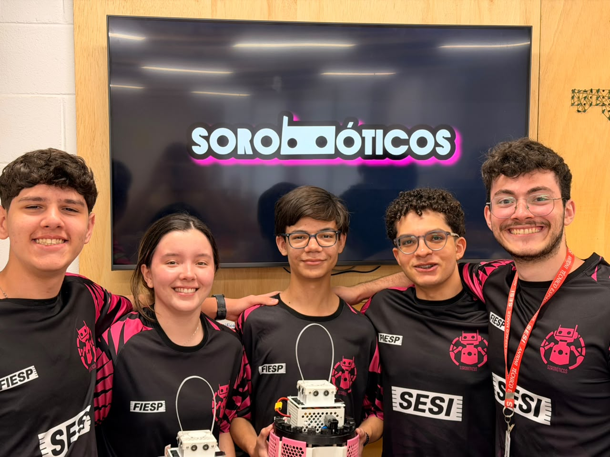

## Membros & Funções

*Qual é o nome de cada membro e quais são as suas funções:*

- Bruno Proença: Integrador de Software;

- Henrique Cabral: Desenvolvedor de Software;

- Gabriela Reche: Projetista Mecânica;

- Heitor Ferreira: Integrador de Hardware.

## Frequência de Reuniões

*Com qual frequência o time de vocês se encontra?*

Nos reunimos presencialmente de 3-5 vezes por semana. Além dos encontros presenciais, também mantemos comunicação frequente de forma online para discutir programação, eletrônica, mecânica e planejamento da estratégia.

## Local das Reuniões

*Onde vocês se reunem para trabalhar no robô?*

Nos reunimos no espaço Fab Lab de nossa escola, onde temos acesso às ferramentas, equipamentos e recursos necessários para o desenvolvimento dos robôs.

## Data de Início

*Quando o seu time começou a trabalhar no robô desse ano?*

Nós começamos a trabalhar no robô em maio 2026, iniciando o planejamento das estratégias, o desenvolvimento mecânico e a programação dos sistemas do robô.

## Competições Passadas

*Em quais competições da RoboCupJunior vocês já participaram e em quais ligas?*

A equipe já participou duas vezes da modalidade RoboCupJunior Rescue Maze, experiência que contribuiu para desenvolver nossos conhecimentos em programação, estratégia, robótica e resolução de desafios autônomos, além de fortalecer o trabalho em equipe e a criação de projetos tecnológicos.

A temporada 2025/2026 marcou nossa estreia na modalidade Soccer. Para dois integrantes, também foi a primeira experiência em competições práticas de robótica, tornando a conquista ainda mais especial. Com esforço, dedicação e colaboração, alcançamos o primeiro lugar na categoria Rookie durante a etapa regional, um marco importante no início da trajetória desses integrantes na robótica. Nessa nova etapa ficamos muito orgulhosos da grande evolução para a etapa Nacional.

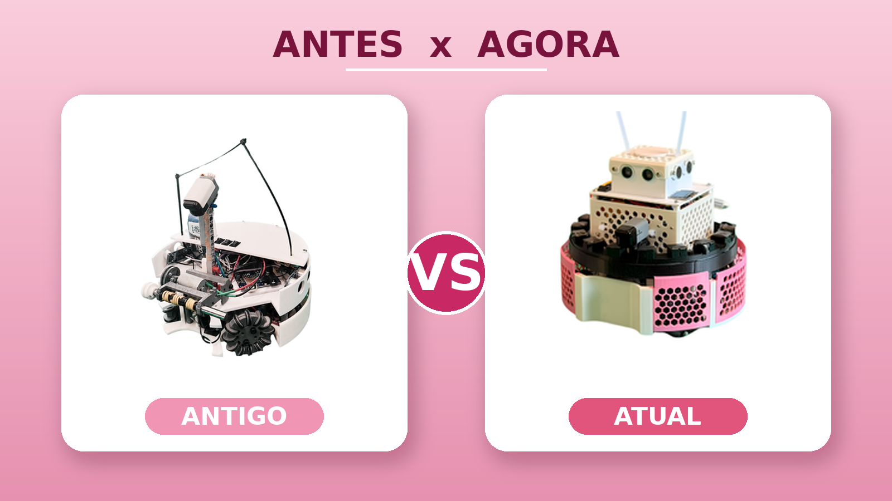

## Contribuição do Mentor

*Quais partes do trabalho que mais tiveram a contribuição do mentor?*

Nosso mentor teve uma contribuição importante principalmente no ensino de modelagem 3D e utilização do Fusion, além de auxiliar no planejamento e organização do projeto. Ele também nos orientou em decisões relacionadas ao design do robô, estratégias de jogo e desenvolvimento geral da equipe, facilitando nosso aprendizado e guiando o grupo durante todas as etapas do projeto.

## Gerenciamento de Tarefas

*Como vocês gerenciaram as tarefas da equipe?*

No início de cada semana, utilizamos um quadro Kanban para organizar e gerenciar as tarefas da equipe. Por meio dessa metodologia, distribuímos as atividades entre os integrantes, acompanhávamos o progresso do projeto e definíamos prioridades para as tarefas mais importantes, garantindo uma melhor organização, comunicação e eficiência no desenvolvimento do robô.

## Ferramentas de IA

Quais ferramentas de IA vocês utilizaram?

Utilizamos ferramentas de inteligência artificial como ChatGPT, Gemini e Claude para auxiliar no desenvolvimento do projeto, principalmente na programação de novos componentes, otimização de algoritmos e identificação de erros no código.

## Robô 1 Geral

*Vista Geral do Robô 1*

## Robô 1 Frente

*Vista Frontal do Robô 1*

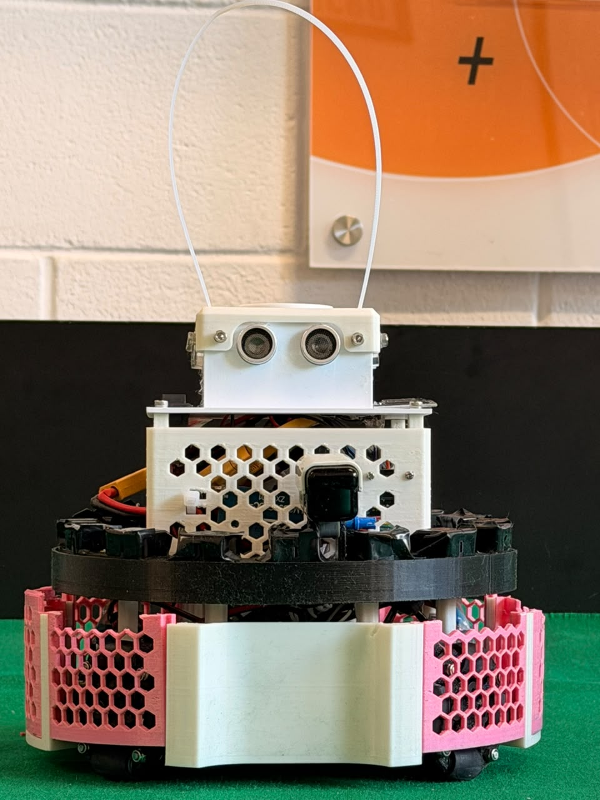

## Robô 1 Traseira

*Vista Traseira do Robô 1*

## Robô 1 Superior

*Vista Superior do Robô 1*

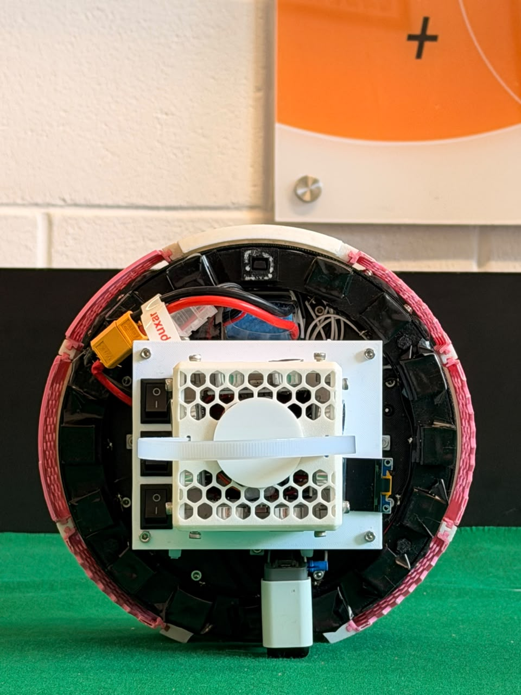

## Robô 1 Inferior

*Vista Inferior do Robô 1*

## Robô 1 Lateral Direita

Vista Lateral Direita do Robô 1

## Robô 1 Lateral Esquerda

*Vista Lateral do Robô 1*

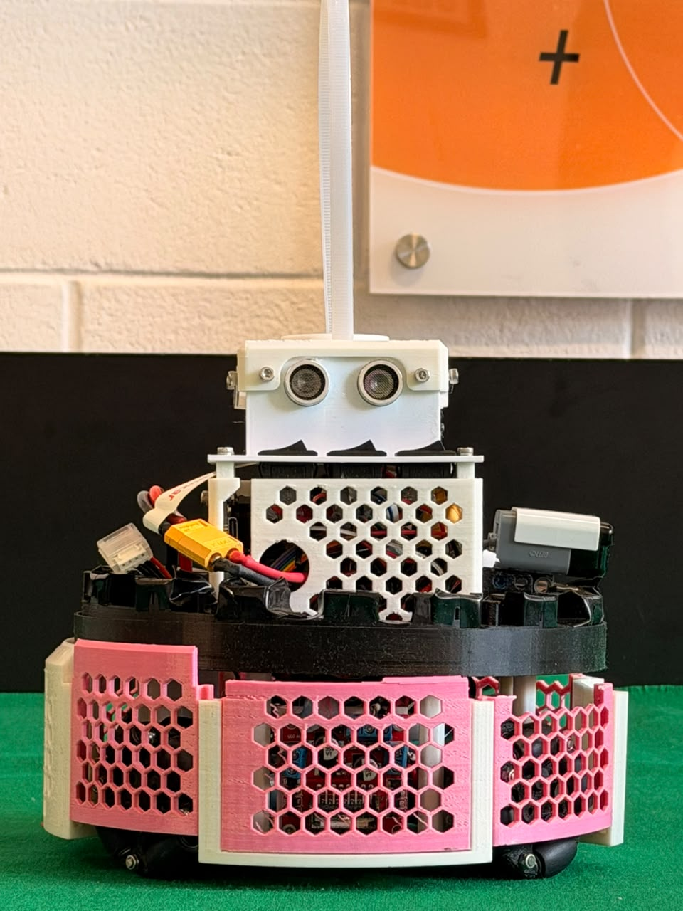

## Posicionamento e Movimentação

*Como você localiza o robô dentro do campo e como você utiliza essa localização para movimentá-lo?*

Nosso robô utiliza **sensores ultrassônicos** e um **sensor giroscópio** para **orientação e localização** dentro do campo. O **giroscópio** é responsável por manter os robôs sempre **orientados em direção ao lado adversário**, garantindo maior estabilidade e precisão durante a movimentação.

Já os **sensores ultrassônicos** permitem estimar a posição do robô no campo por meio da obtenção de coordenadas aproximadas nos eixos X e Y. Com essas informações, conseguimos implementar movimentações mais estratégicas, como direcionar o robô para posições específicas durante o ataque, facilitando o alinhamento e a realização dos chutes.

Essa escolha reflete nossa aplicação da **metodologia KISS (*Keep It Super Simple*)**, que busca simplificar o sistema sem comprometer sua eficiência. Na etapa regional, utilizávamos sensores de refletância LDR, que ocupavam mais espaço, exigiam uma quantidade maior de pinos do Arduino e dependiam de um anel de LEDs, aumentando o consumo de bateria. Ao substituir esse conjunto por sensores ultrassônicos, conseguimos reduzir a complexidade do sistema, otimizar o uso dos componentes e simplificar a estrutura eletrônica do robô.

Durante o desenvolvimento, tivemos bastante cautela na implementação dos sensores ultrassônicos devido à possibilidade de interferências causadas por outros robôs e pela própria bola. Por isso, realizamos testes e ajustes para aumentar a confiabilidade das leituras durante as partidas.

## Robô 2 Geral

*Vista Geral do Robô 2*

## Frente Robô 2

*Vista Frontal do Robô 2*

## Robô 2 Traseira

*Vista Traseira do Robô 2*

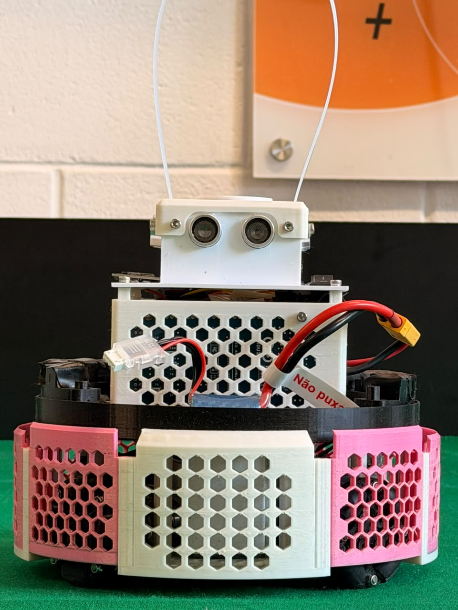

## Robô 2 Superior

*Vista Superior do Robô 2*

## Robô 2 Inferior

*Vista Inferior do Robô 2*

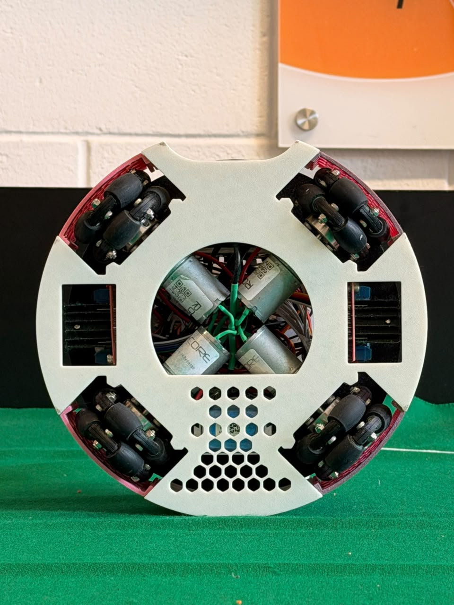

## Robô 2 Lateral Direita

*Vista Lateral Direita do Robô 2*

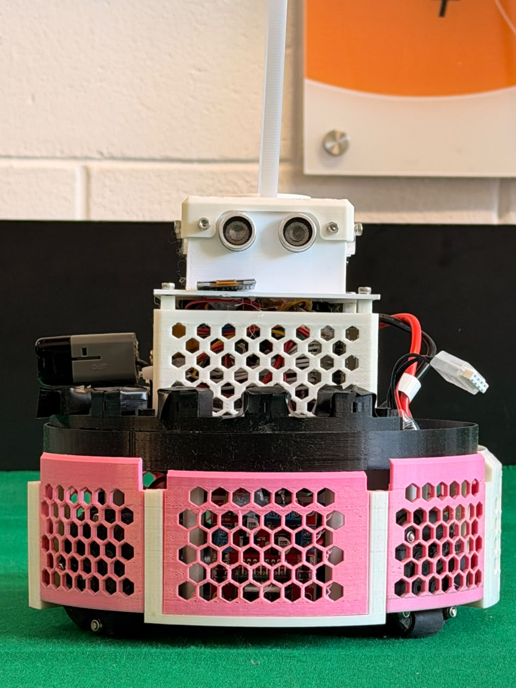

## Robô 2 Lateral Esquerda

*Vista Lateral Esquerda do Robô 2*

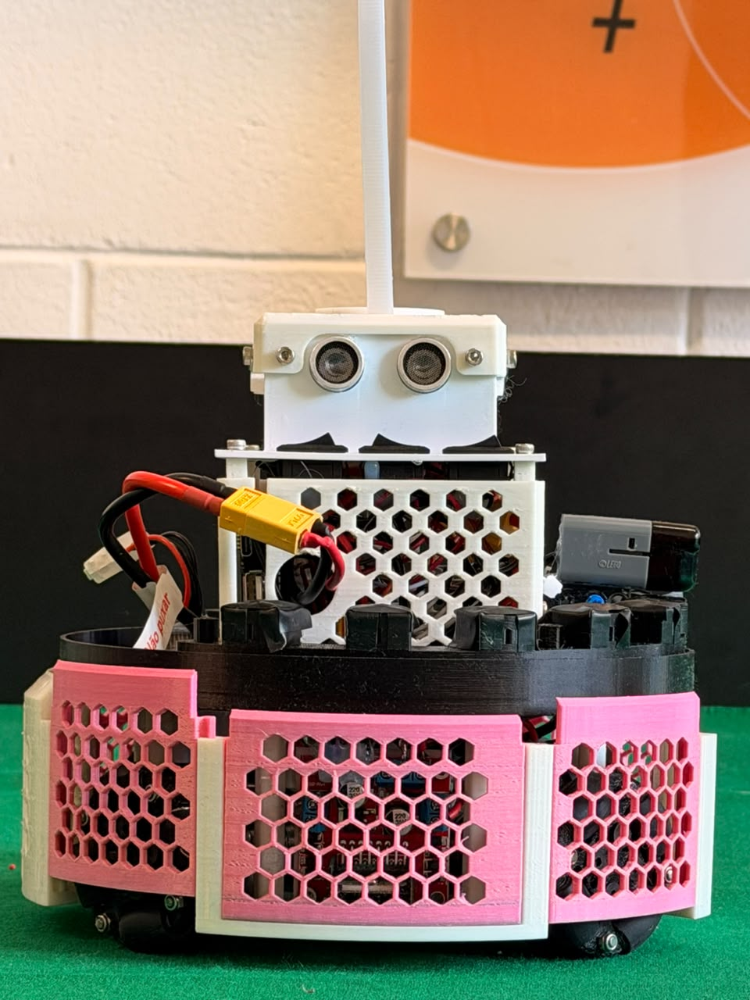

## Design Mecânico

*Como vocês fizeram o design das partes mecânicas do seu robô?*

Utilizamos o Fusion 360 para modelar o chassi e os principais componentes do robô. O projeto passou por várias etapas de prototipagem e testes, que nos permitiram aprimorar a estrutura e o desempenho mecânico. No chassi inferior, incorporamos um encaixe do tipo cauda de andorinha, com 1 mm de espessura, para facilitar a manutenção, reduzir o risco de quebra e ajudar a proteger as partes ao redor do robô.

As peças foram produzidas por impressão 3D, utilizando principalmente filamento ABS. As exceções são os eixos das rodas, feitos de arame de aço trefilado de 1/8 de polegada, e os roletes: os deslizantes foram produzidos em resina ABS Like e os flexíveis em resina 3D CureFlex. Escolhemos o ABS por sua rigidez, resistência mecânica e durabilidade, características importantes para suportar o uso e os impactos durante as partidas, na seleção comparamos esse material com o ApexCarbo e TPU, como representado pelo gráfico comparativo. O uso predominante desse material também contribuiu para padronizar a fabricação das peças.

Para equilibrar resistência e peso, avaliamos diferentes padrões de preenchimento e adotamos o padrão favo de mel (honeycomb), por oferecer uma boa relação entre essas características. As paredes das partes gerais do robô possuem 3 mm de espessura, enquanto o chassi inferior tem 4 mm, o que aumenta sua resistência a impactos. Definimos essas espessuras considerando a exposição de cada peça a possíveis colisões, buscando manter o robô leve sem comprometer a resistência necessária para seu funcionamento.

O chassi circular foi projetado com posições específicas para os componentes, facilitando a organização interna e a manutenção. Também desenvolvemos peças, como as rodas, para que se integrassem ao conjunto. A distribuição dos componentes foi planejada para manter o centro de gravidade baixo e favorecer a estabilidade do robô durante os deslocamentos e as mudanças de direção.

Ao final do processo, os robôs apresentaram 21,5 cm de diâmetro e 20 cm de altura. O robô atacante atingiu 1.485 g, e o goleiro, 1.460 g.

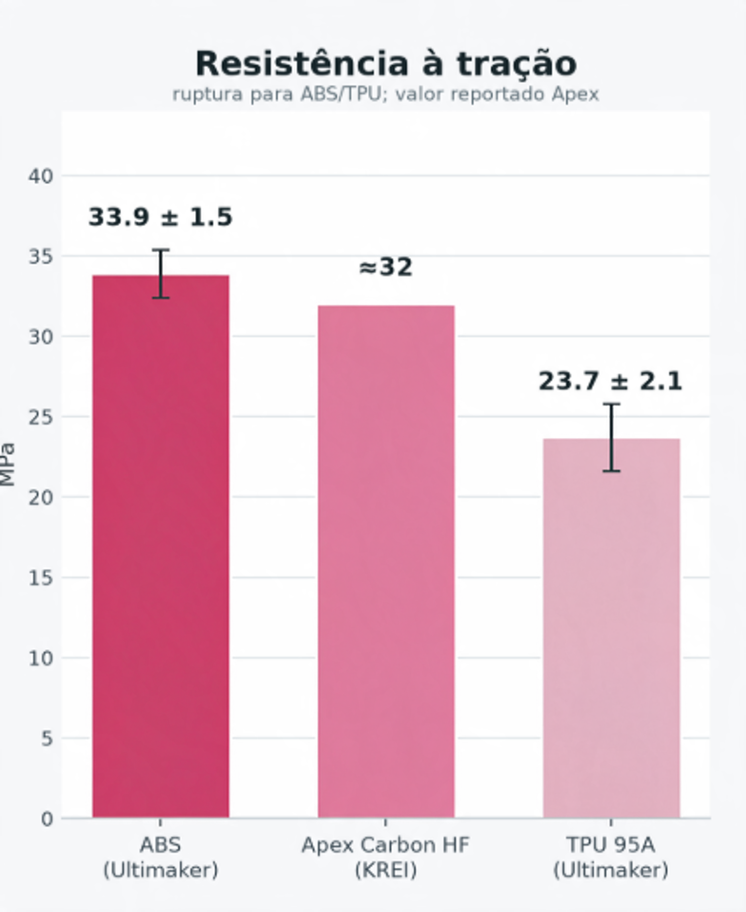

**Gráfico — Seleção de materiais**. **Autores:** Sorobóticos.

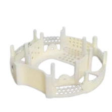

**Imagem — Chassi inferior**. **Autores:** Sorobóticos.

## Método de Construção

*Como você construiu o seu design?*

Nossa estratégia de desenvolvimento consistiu na utilização de um **robô de testes**, que foi **modificado manualmente ao longo do projeto**. A estrutura foi lixada, ajustada e adaptada diversas vezes até que obtivéssemos um resultado próximo ao esperado. Essa abordagem permitiu realizar testes mecânicos e de programação sem a necessidade de imprimir um novo chassi a cada alteração, **reduzindo significativamente o consumo de filamento e o tempo de desenvolvimento**.

Além disso, para testar peças e encaixes produzidos por manufatura aditiva, adotamos a estratégia de **imprimir apenas a região necessária para cada teste**, em vez de produzir o chassi inteiro. Para isso, cortávamos o modelo no Orca Slicer e imprimíamos somente a parte que precisava ser avaliada. **Essa prática facilitou a prototipagem** e permitiu realizar **ajustes com mais rapidez**, conseguindo assim **economizar em média de uma a duas horas a cada teste de peça**, economizando material e tempo.

**Após a validação** dos principais conceitos no robô de testes, **fabricamos o chassi definitivo por impressão 3D**, incorporando todas as melhorias identificadas durante os experimentos. As **demais peças** produzidas por manufatura aditiva, como suportes e rodas, **seguiram a mesma metodologia**: inicialmente eram testadas e ajustadas em protótipos, e somente após sua validação eram impressas em sua versão final.

Em seguida, realizamos a montagem completa do robô, instalando os sistemas mecânicos, eletrônicos e de controle. Por fim, novos testes foram conduzidos para verificar a integração entre os componentes e garantir o desempenho, a estabilidade e a confiabilidade do sistema durante as partidas.

## Motores e Razão

*Quantos motores vocês usaram e por quê?*

A movimentação do robô é realizada por 4 motores de corrente contínua de 12 V e 1000 RPM, cada um acoplado a uma roda omnidirecional. Essa configuração permite deslocamentos em múltiplas direções, proporcionando maior agilidade e liberdade de movimentação.

Na etapa regional, utilizávamos motores de 500 RPM. Entretanto, como nossa estratégia é baseada em movimentações rápidas e respostas ágeis durante as partidas, identificamos que essa configuração já não atendia às nossas necessidades. Por isso, optamos por motores de 1000 RPM, que possuem o dobro da rotação nominal dos anteriores. Considerando as mesmas condições de alimentação e carga, essa alteração permite atingir uma velocidade de rotação até 90% maior, contribuindo para deslocamentos mais rápidos e melhor resposta durante as jogadas.

## Design do Kicker

*Se o robô tiver um kicker, explique como foi projetado e contruído o mecanismo do kicker?*

Durante o desenvolvimento do robô, avaliamos diferentes estratégias de finalização, considerando a possibilidade de incorporar um sistema kicker para impulsionar a bola em direção ao gol adversário. Para isso, comparamos o desempenho de duas configurações: uma utilizando um mecanismo específico de chute e outra baseada exclusivamente na força de movimentação dos motores de tração. Observamos que os motores, com velocidade de 1000 RPM, já proporcionavam força suficiente para conduzir e impulsionar a bola durante as finalizações. Assim, concluímos que um mecanismo adicional não traria benefícios significativos ao desempenho do robô, optando por priorizar a velocidade, a agilidade e a simplicidade do projeto.

## Design do Dribbler

*Se o robô tiver um dribbler, explique como vocês projetaram e construiram o mecanismo do dribbler.*

Durante o desenvolvimento do robô, testamos diferentes configurações do dribbler, realizando adaptações no motor e avaliando sua integração com a movimentação do sistema. Comparamos o desempenho do robô com e sem o mecanismo, considerando principalmente a capacidade de captura da bola, a velocidade de deslocamento e a eficiência nas finalizações. Observamos que o dribbler facilitava a captura e a retenção da bola, proporcionando maior controle durante a condução. Entretanto, essa configuração exigia movimentos mais precisos e controlados, limitando a agilidade do robô. Por outro lado, sem o mecanismo, conseguimos aproveitar melhor a velocidade dos motores de tração, permitindo deslocamentos mais rápidos e respostas mais dinâmicas. Dessa forma, optamos por não utilizar o dribbler, priorizando a velocidade e a capacidade de reação do robô, que passou a conduzir a bola por meio de seu próprio posicionamento e movimentação.

## Inovação Mecânica

*Inovação Mecânica*

Nossa principal inovação foi o desenvolvimento de **rodas duplas** com **roletes deslizantes e flexíveis**, modeladas no Fusion 360 para **ampliar o contato da borracha com o solo da arena** **e melhorar a aderência e a movimentação** do robô. A **estrutura** das rodas foi impressa em **ABS**; o **rolete deslizante, em resina ABS Like; e o rolete flexível, em resina 3D Cure Flex**. Para os **eixos**, utilizamos **aço trefilado de 1/8 de polegada**. Também usamos **arruelas** entre os roletes e as rodas para **ajudar a manter as peças posicionadas** corretamente.

O projeto foi revisado para **corrigir problemas identificados na etapa regional**. **Parafusos** posicionados **entre os roletes ajudam a evitar que eles escapem**, e os eixos de **aço trefilado** **substituíram os parafusos** usados anteriormente nessa função, **reduzindo a rigidez excessiva do conjunto.**

Para avaliar as mudanças, **realizamos testes comparativos de aderência, estabilidade e durabilidad**e, usando as duas **versões de roda no mesmo robô**. Nos testes de aderência, a versão anterior apresentou desempenho inferior, associado ao maior espaçamento entre os roletes. A estabilidade e a durabilidade também foram prejudicadas por pontos críticos mais suscetíveis a falhas. Essas observações **orientaram o redesenho e as melhorias na fixação e no funcionamento do mecanismo.**

O **professor Diego Rossi** acompanhou o processo de criação e planejamento, ajudando na escolha dos materiais e no desenvolvimento da estrutura das rodas. Sua orientação ampliou nosso conhecimento de mecânica e contribuiu para impulsionar o projeto. Ele é **mestre em Ciência e Tecnologia de Materiais pela Unesp, tecnólogo em Processos de Produção e em Projetos Mecânicos** pela Fatec Sorocaba e pós-graduado em Educação do Ensino Superior.

**Suporte TSOP:** O suporte de sensores TSOP passou por várias etapas de modelagem e testes até chegarmos à abertura final, com 4 mm de altura por 0,5 mm de largura, que equilibrou a detecção da bola e a redução do vazamento de sinal. Para testar diferentes medidas mais rapidamente, imprimíamos apenas uma parte do ring de um a três suportes TSOP em vez de fabricar o conjunto inteiro a cada tentativa. Essa técnica reduziu o tempo de impressão e facilitou a comparação entre diferentes larguras de abertura até definirmos a configuração final.

**Encaixe Andorinha:** implementamos encaixes do tipo cauda de andorinha, permitindo acessar e substituir diferentes partes do robô com mais facilidade.

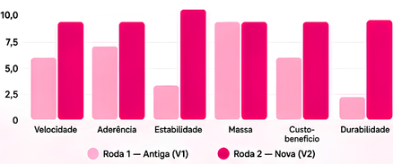

**Gráfico comparativo das rodas — Rodas**. **Autores:** Sorobóticos.

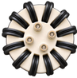

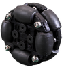

V1 V2

**Imagem — Rodas V1 e V2**. **Autores:** Sorobóticos.

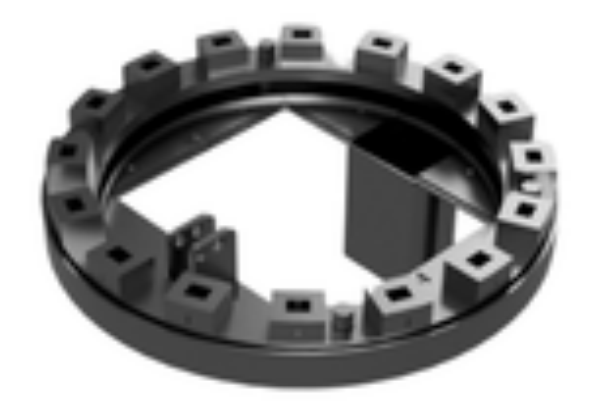

**Imagem — Suporte TSOP**. **Autores:** Sorobóticos.

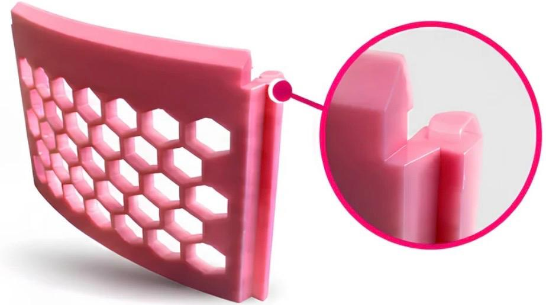

**Imagem — Encaixe Andorinha**. **Autores:** Sorobóticos.

## Diagrama da Eletrônica

*Forneça-nos um diagrama da eletrônica do seu robô*

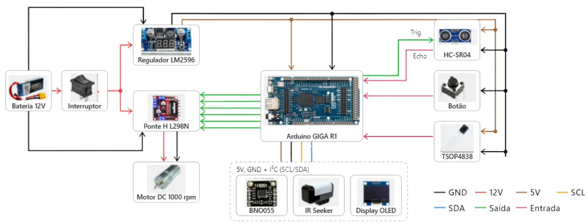

**Diagrama de Eletrônica — Eletrônica**. **Autores:** Sorobóticos.

## Circuito de Energia

*Como o circuito de energia funciona?*

O sistema é alimentado por uma única bateria de 12,6 V, conectada diretamente às pontes H L298N, responsáveis pelo acionamento dos motores. Cada motor apresenta uma corrente de pico de 6,5 A, característica considerada no dimensionamento do sistema de alimentação. Um regulador de tensão dedicado é responsável por alimentar o Arduino, os sensores e os demais componentes eletrônicos de controle, adequando a tensão de saída às especificações de cada dispositivo. O regulador utilizado apresenta tolerância máxima de ±4% na tensão de saída, conforme as especificações do fabricante.

Essa configuração permite atender às demandas energéticas dos diferentes componentes, além de simplificar o gerenciamento e o processo de recarga da bateria.

Para estimar a autonomia do sistema, foram realizados cálculos considerando um fator de segurança igual a 2, posteriormente complementados por testes práticos. Durante os ensaios, o robô apresentou autonomia mínima de 30 minutos, resultado considerado satisfatório, uma vez que atende ao tempo de duração das partidas, estabelecido em 10 minutos.

## Circuito do Motor

Como você controla os motores? Explique os circuitos que você utiliza para isso.

Foram utilizadas duas placas driver L298N (ponte H) para o acionamento dos motores de tração. A interface de controle é realizada por meio de um Arduino, responsável pela geração dos sinais de modulação por largura de pulso (PWM). Cada motor é acionado por três pinos de controle, sendo dois destinados à definição do sentido de rotação e um utilizado para o controle da velocidade por PWM, permitindo um ajuste preciso do desempenho do sistema. A alimentação das pontes H é fornecida diretamente pela bateria de 12 V, sem passar pelo regulador de tensão LM2596, garantindo o fornecimento de corrente de pico necessária aos motores.

## Microcontrolador & Razão

*Qual tipo de microcontrolador ou placa vocês usaram para o robô? Por que você decidiu usar essa peça para o seu robô? Se o usou mais de um processador, explique-os separadamente*

Para o controle central do robô, utilizamos a placa Arduino GIGA R1 WiFi, baseada no microcontrolador STM32H747XI. Ele possui dois núcleos de processamento: um Cortex-M7 de 480 MHz e um Cortex-M4 de 240 MHz. A placa conta com 2 MB de memória Flash e 1 MB de RAM interna, além de memória externa disponível para aplicações que necessitem de mais espaço. Essa capacidade oferece recursos para executar a lógica de jogo e processar as leituras dos sensores em tempo real.

Conexão dos componentes: a placa oferece até 76 pinos digitais, 12 entradas analógicas e interfaces de comunicação como UART, I²C e SPI. Essa variedade facilita a integração dos 16 sensores TSOP4838 que utiliza entradas digitais, os sensores ultrassônicos e dos demais componentes de controle do robô. A placa também possui Wi-Fi e Bluetooth integrados; esses recursos estão disponíveis, embora seu uso durante as partidas dependa da programação e da configuração do robô.

Controle dos motores: o Arduino processa as informações recebidas e envia os sinais de controle aos drivers, que acionam os motores. Os motores não são alimentados diretamente pelos pinos da placa. Como o GIGA R1 WiFi trabalha com lógica de 3,3 V, as ligações com sensores, drivers e outros módulos devem ser compatíveis com esse nível elétrico.

## Detecção da Bola

*Como o seu sensor de detecção da bola e/ou sua câmera(s) funciona?*

Para a identificação da bola infravermelha, tanto o **robô atacante** quanto o **robô goleiro** utilizam sensores **TSOP4838**, sendo 16 sensores no atacante e 11 no goleiro, responsáveis por receber os sinais infravermelhos modulados em 38 kHz, emitidos pela bola. Em conjunto com esses sensores, utilizamos o **HiTechnic IR Seeker**, que permite estimar a intensidade do sinal recebido, fornecendo informações que auxiliam na avaliação da proximidade da bola.

A combinação desses sensores permite identificar a presença e a direção da bola, além de fornecer informações para orientar a movimentação dos robôs de acordo com suas respectivas funções. Dessa forma, o sistema de sensoriamento infravermelho contribui para uma localização mais eficiente da bola, permitindo respostas mais rápidas e precisas durante as partidas.

## Detecção da Linha

*Como o circuito de detecção de linha do seu robô funciona?*

Nosso robô não utiliza sensores de detecção de linha. Em seu sistema de sensoriamento, é empregado o sensor ultrassônico HC-SR04, responsável por identificar as paredes por meio da emissão e recepção de ondas ultrassônicas, permitindo estimar a distância entre o robô e as paredes. Dessa forma, o sensor auxilia na percepção do espaço ao redor e contribui para uma navegação mais segura e eficiente durante as partidas.

\
**Sensores de Posição/Navegação**
------------------------------------------------------------

*Quais sensores vocês usaram para a navegação e como eles são conectados com o processador? Quais sensores vocês para se posicionar no campo? E quanto ao senso de direção do robô?*

Para a navegação e posicionamento no campo, utilizamos quatro sensores ultrassônicos conectados diretamente ao microcontrolador do robô por meio de portas digitais de entrada e saída. Esses sensores medem continuamente a distância até as bordas da quadra, permitindo estimar a posição do robô nos eixos X e Y. Com essas informações, o sistema consegue determinar sua localização aproximada dentro do campo e ajustar sua trajetória quando necessário.

Além dos sensores ultrassônicos, utilizamos o sensor inercial BNO055, que integra acelerômetro e giroscópio. Esse sensor é conectado ao processador por meio do protocolo de comunicação I²C fornece informações sobre a orientação angular do robô em tempo real.

O BNO055 é responsável pelo senso de direção do robô, permitindo a realização de giros precisos e o controle do ângulo do chute, assim como a direção do gol adversário.

## Circuito do Kicker

*Como vocês conduziram o sistema do kicker? Como como o circuito do kicker faz ele funcionar?*

Com a decisão de não utilizar o kicker, optamos por eliminar seu circuito eletrônico e os componentes necessários ao acionamento do mecanismo. Essa escolha simplificou a arquitetura eletrônica, reduziu a quantidade de componentes e diminuiu a complexidade da programação. Dessa forma, mantivemos a proposta da metodologia **KISS,** priorizando soluções eficientes com o menor nível de complexidade possível.

## Circuito do Dribbler

*Como o sistema do seu dribbler funciona? Quais componentes e circuitos vocês usaram para controlá-lo?*

A partir da decisão de não implementar o dribbler, eliminamos o circuito responsável pelo acionamento e controle de seu motor. Isso reduziu a quantidade de componentes eletrônicos, simplificou as conexões e diminuiu a complexidade da programação. Além disso, permitiu concentrar os recursos de processamento e alimentação nos sistemas essenciais de movimentação e localização da bola. Essa escolha reforça a aplicação da metodologia **KISS,** priorizando uma arquitetura mais simples, eficiente e funcional.

## PCB

*PCB do robô?*

Para minimizar problemas de mau contato elétrico, foram soldados pinos machos aos trilhos, garantindo uma conexão mais estável e confiável com o Arduino. Essa solução também visa otimizar o processo de montagem, reduzindo os custos de fabricação e o tempo necessário para a produção de PCBs dedicadas.

## Inovação

*Inovações*

Visando aprimorar a organização e otimizar o desenvolvimento do projeto, criamos o **Sorosoccer**, um simulador próprio desenvolvido para permitir o trabalho na programação dos robôs enquanto as versões físicas estavam em montagem ou manutenção. A plataforma oferece duas modalidades de interação: o controle manual dos robôs e a programação diretamente pelo site, utilizando uma linguagem semelhante a C++. Por meio do simulador, é possível testar algoritmos, reproduzir comportamentos de movimentação e simular partidas completas no formato 2x2. Essa inovação foi fundamental para otimizar nosso fluxo de trabalho, permitindo que o desenvolvimento e os testes da programação continuassem mesmo quando os robôs físicos não estavam disponíveis, reduzindo o tempo ocioso da equipe e acelerando o processo de aprimoramento das estratégias.

Outra inovação foi a divisão do código principal entre os dois núcleos de processamento do Arduino GIGA R1 WiFi. Considerando a alta velocidade e o dinamismo das partidas de RoboCup Soccer, optamos por utilizar essa arquitetura, distribuindo as tarefas entre o processamento dos sensores infravermelhos (TSOP4838) e a execução da lógica principal de controle e movimentação do robô. Essa divisão permitiu a execução de tarefas de forma assíncrona, reduzindo a sobrecarga do processamento principal e melhorando a capacidade de resposta do sistema. Como resultado, obtivemos maior reatividade e agilidade nas tomadas de decisão, tornando o robô mais eficiente durante as partidas.

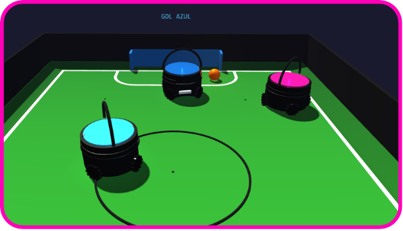

**Imagem — Simulador SoroSoccer**. **Autores:** Sorobóticos.

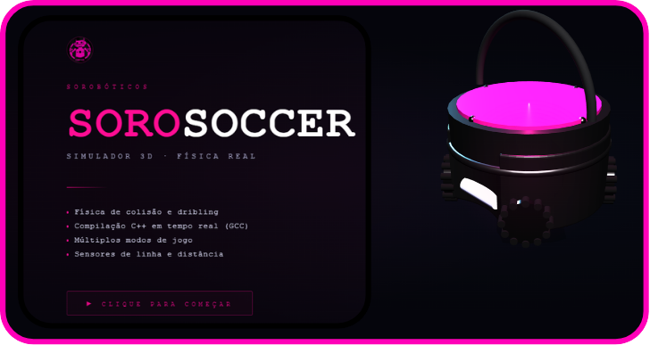

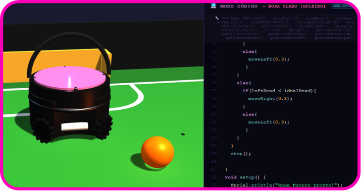

**Imagem — Simulador SoroSoccer**. **Autores:** Sorobóticos.

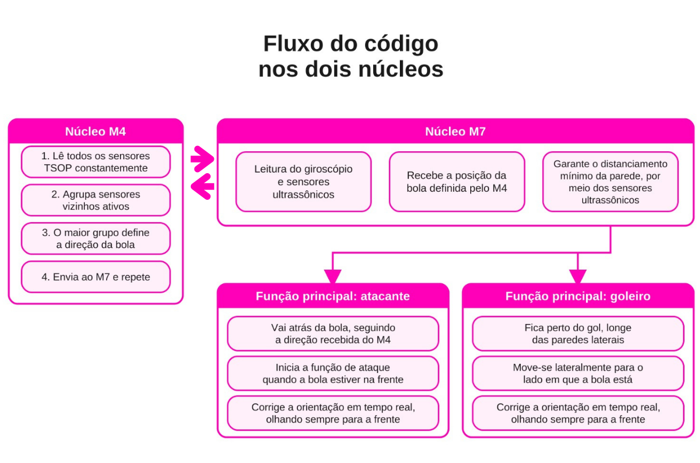

**Fluxo — Fluxo do código**. **Autores:** Sorobóticos.

## Controle do Motor

*Como o processador é usado para controlar os motores?*

A arquitetura de controle do robô é baseada no microcontrolador Arduino Giga R1 wifi, que se comunica com dois módulos driver L298N em ponte H dupla para gerenciar o sistema de rotação. Cada motor de corrente contínua é acionado por três linhas de controle: dois pinos digitais (IN1 e IN2) definem o sentido de rotação, enquanto um pino de habilitação (EN) regula a velocidade e a potência via sinais de Modulação por Largura de Pulso (PWM) do microcontrolador.

## Método de Detecção da Bola

*Como o robô detecta a bola? Como o robô lê os dados do sensor de detecção da bola ou da câmera?*

Para a localização da bola em campo, nosso robô utiliza um sistema de rastreamento infravermelho que combina os sensores receptores **TSOP4838** e o **HiTechnic IR Seeker**, componentes que desempenham funções complementares na identificação da bola oficial da RoboCup.

- **Captação de sinais infravermelhos:** Os sensores TSOP4838 são projetados para receber sinais infravermelhos modulados em 38 kHz, frequência utilizada pela bola oficial. Essa característica permite filtrar grande parte das interferências provenientes da iluminação ambiente e de outras fontes de luz infravermelha.

- **Identificação de direção e intensidade:** Além dos TSOP4838, utilizamos o **HiTechnic IR Seeker**, que possui múltiplos elementos receptores distribuídos em diferentes direções. O sensor compara os sinais recebidos por esses elementos e fornece informações sobre a direção de origem do sinal infravermelho. Também disponibiliza um valor de intensidade, que auxilia na estimativa da proximidade da bola em relação ao robô.

- **Processamento dos dados:** As informações dos sensores são processadas pelo **Arduino GIGA R1 WiFi**, responsável por interpretar os sinais recebidos e transformá-los em dados utilizados pelo sistema de navegação. Por meio de rotinas de software, essas informações são organizadas para identificar a direção da bola e orientar as decisões de movimentação.

- **Integração com o sistema de movimentação:** Os dados processados são utilizados pelo algoritmo de navegação omnidirecional, permitindo que o robô ajuste seus deslocamentos de acordo com a posição da bola. Dessa forma, o sistema combina a identificação direcional dos TSOP4838 com as informações de direção e intensidade do HiTechnic IR Seeker, contribuindo para uma localização mais eficiente e uma resposta ágil durante as partidas.

## Algoritmo de Condução da Bola

*Como o algoritmo de pegar a bola funciona? Há alguma diferença entre os robôs na forma que eles se movem em direção à bola?*

Ambos os robôs utilizam 16 sensores TSOP 4838 para identificar a direção da bola por meio da detecção de sinais infravermelhos. Além disso, o robô atacante conta com um sensor HiTechnic IR Seeker, que fornece informações sobre a intensidade do sinal recebido, permitindo estimar a proximidade da bola e realizar ajustes mais precisos e responsivos durante a aproximação.

Com base nas informações de direção e intensidade, os robôs determinam a trajetória necessária para alcançar a bola. Entretanto, suas estratégias de movimentação diferem de acordo com suas funções na equipe.

O robô atacante busca se posicionar atrás da bola, mantendo-a entre ele e o gol adversário. Essa estratégia favorece a aquisição e o controle da bola, além de permitir que o robô avance em direção ao gol sem realizar rotações desnecessárias durante a movimentação.

Já o robô goleiro desloca-se em direção à bola para interceptá-la e realizar bloqueios, respeitando os limites de sua área defensiva. Sua movimentação é restrita à região próxima à linha de pênalti, evitando que se afaste excessivamente do gol e comprometendo sua capacidade de defesa.

## Algoritmo da Linha

*Como o seu robô identifica a linha para se manter dentro do campo? Quais algoritmos foram usados para evitar que o robô saia da area?*

O robô utiliza os sensores ultrassônicos para estimar sua posição em relação aos limites do campo e evitar ultrapassá-los. Para isso, compara as leituras de sensores posicionados em direções opostas, como esquerda e direita. A análise conjunta desses valores permite identificar possíveis interferências nas medições, como a presença de robôs adversários, tornando a interpretação das distâncias mais confiável.

Quando a leitura de um sensor ultrassônico fica abaixo de um limite previamente definido, o sistema identifica uma possível aproximação da borda correspondente e inicia um movimento na direção oposta, afastando o robô da linha e mantendo-o dentro da área de jogo.

Esse algoritmo é executado continuamente no loop principal do programa e possui prioridade sobre os demais comportamentos do robô. Assim, sempre que uma situação de risco é identificada, a execução das estratégias de ataque ou defesa é temporariamente interrompida, permitindo que o robô realize a manobra de afastamento. Após recuperar uma distância segura em relação à borda, os demais algoritmos são retomados.

## Algoritmo de Gols

*Quais algoritmos vocês usaram para marcar gols? Como vocês usaram o dribbler e o kicker para conduzir a bola?*

O modo de ataque é ativado quando as leituras do IR Seeker e do TSOP4838 coincidem e indicam que a bola está à frente do robô, o que confirma a posse. A partir daí, a estratégia ofensiva depende da posição do robô em campo, estimada pelas leituras dos sensores ultrassônicos, que também indicam onde está o gol. Com base nisso, o robô escolhe a trajetória mais adequada: avançar pela lateral esquerda, pela lateral direita ou diretamente ao gol, quando já está bem-posicionado para a finalização. Ao atingir uma distância adequada do gol, interrompe o deslocamento e faz o alinhamento final por meio de uma rotação controlada. Depois de alinhado, avança e impulsiona a bola em direção ao gol para finalizar.

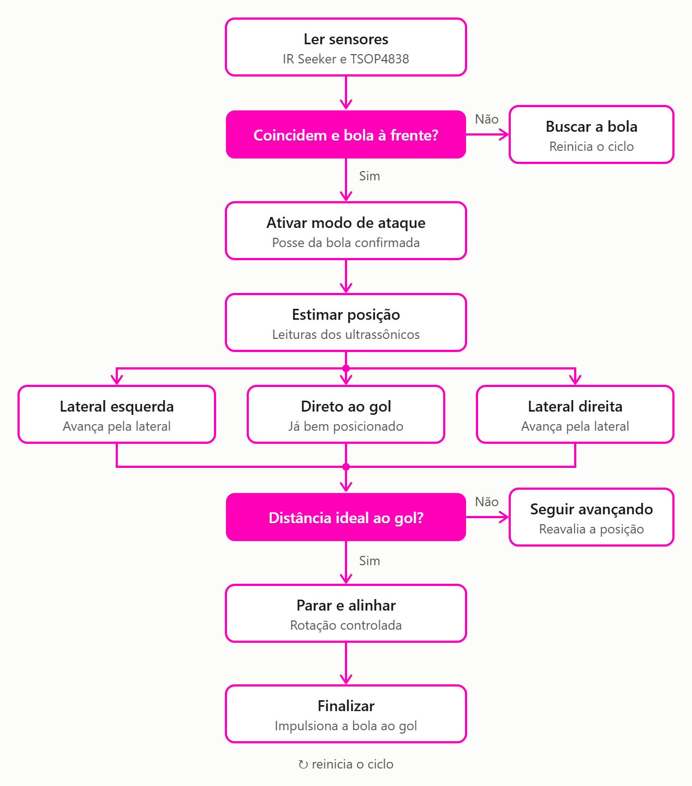

**Fluxo — Robô atacante**. **Autores:** Sorobóticos.

## Algoritmo de Defesa

*Quais algoritmos vocês usaram para impedir que o time adversario marque gols? Como os seus robôs defendem o próprio gol?*

O robô atacante adota uma estratégia de posicionamento defensivo, buscando permanecer sempre entre a bola e o próprio gol. Dessa forma, atua como uma barreira contra o avanço dos adversários, dificultando aproximações e possíveis finalizações. Para evitar interferências na atuação do goleiro, o atacante utiliza o sensor ultrassônico traseiro para estabelecer um limite de deslocamento, impedindo que avance excessivamente em direção à área defensiva e mantendo-se preferencialmente próximo ou à frente da linha central do campo.

O robô goleiro, por sua vez, permanece prioritariamente posicionado sobre a linha de pênalti, garantindo uma cobertura constante do gol. Com base nas informações obtidas pelos sensores, acompanha o deslocamento da bola e ajusta seu posicionamento para interceptar possíveis finalizações. Em situações específicas, quando identifica que a bola está próxima e permanece parada por um curto intervalo, o goleiro realiza um avanço temporário para afastá-la ou chutá-la em direção ao campo adversário, retornando posteriormente à sua posição defensiva.

Lógica do atacante // Lógica do goleiro

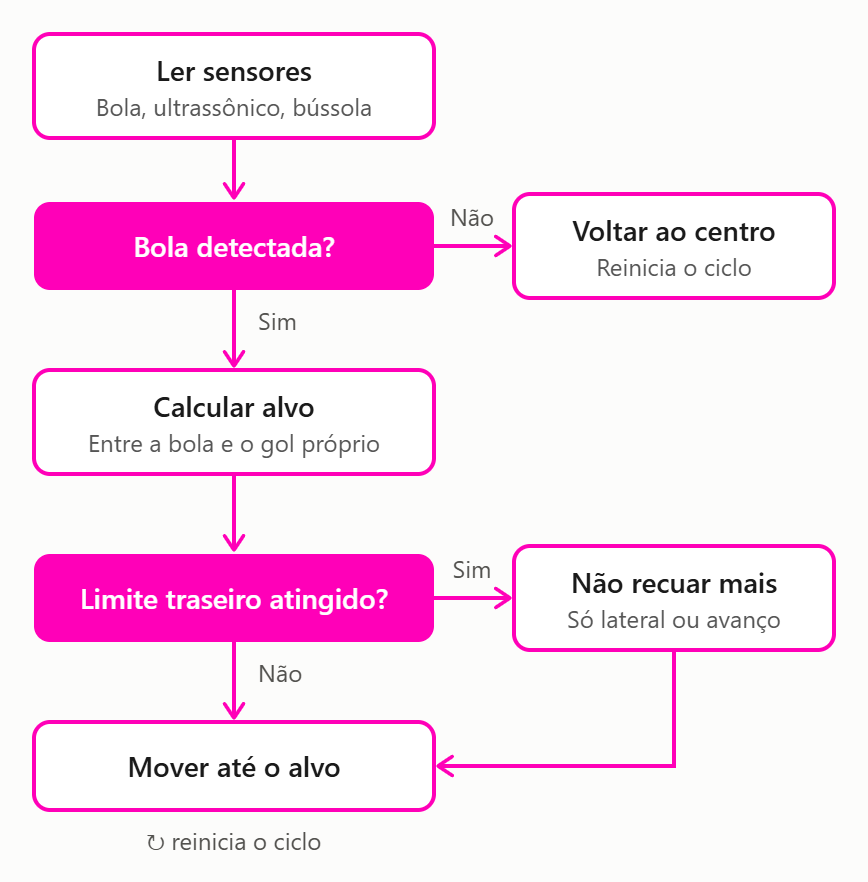

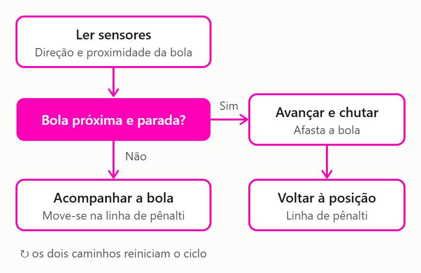

**Fluxo — Atacante Autores:** Sorobóticos. **Fluxo — Goleiro**. **Autores:** Sorobóticos.

## Comunicação do Robô

*Os seus robôs se comunicam entre si? Como vocês usam essa comunicação para obter vantagem?*

Os robôs não possuem comunicação direta entre si durante a partida. No entanto, cada um é programado com funções bem definidas, atacante e goleiro, o que garante um comportamento coordenado e complementar em campo. Essa divisão de papéis evita conflitos de decisão e reduz a chance de os robôs se atrapalharem, permitindo que atuem de forma harmônica.

## Link GitHub

*Link do GitHub*

[*https://github.com/Soroboticos-Soccer/nacional-soccer-2026*](https://github.com/Soroboticos-Soccer/nacional-soccer-2026)

## Lista de Materiais

*Lista de Materiais*

[BOM.xlsx](https://sesisenaispedu-my.sharepoint.com/:x:/g/personal/antoni_frigerio_portalsesisp_org_br/IQARvzUoNFhvR7zJtImBCNMOAaJihk4XXiH-QJTbcqsfziY?e=YRPKEP)

## Custo

*Quanto custou para construir o robô?*

***Robôs*** (componentes em uso):**3.439,10 BRL cada robô;**

***Experimentos*** (falhas de construção, quebra, hardware.): **1.634,7 BRL;**

## Fundos

*Como vocês conseguiram os fundos para construir o robô*

Todos os gastos foram custeados pela escola SESI

## Acessibilidade

*Quão accessivel foi para completar o RoboCupJunior Soccer*

## Conferir Respostas

*Vocês conferiu todas as suas respostas?*

Sim!

## Consentimento de Publicação

*Nos publicamos os TDPs e os Posters durante ou depois da competição como descrito no início*

## Endereço de E-mail

*Endereço de e-mail*

[*soroboticossoccer@gmail.com*](mailto:soroboticossoccer@gmail.com)

## Arquivo TDP

[*https://github.com/Soroboticos-Soccer/regional-soccer-2026/tree/main/TDP*](https://github.com/Soroboticos-Soccer/regional-soccer-2026/tree/main/TDP)

## Extra Column

*Column 67*
